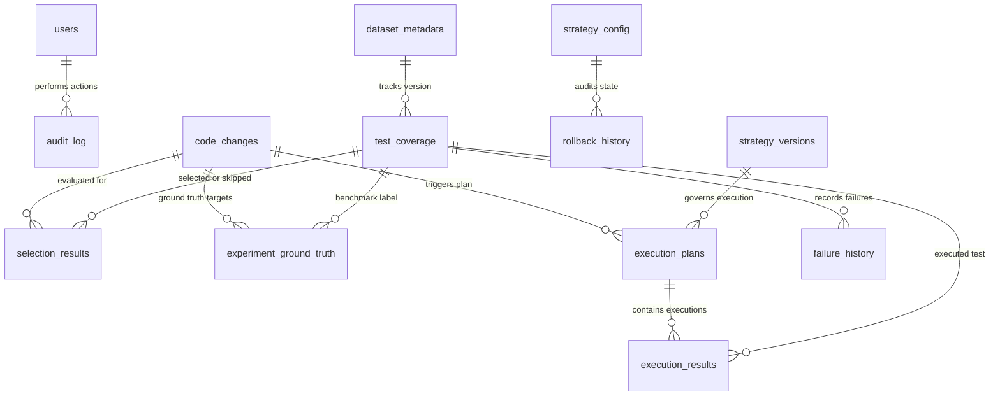

# TestSphere.AI

**Change Impact Test Selector — Mobile Banking Regression Testing**

> **Design Principle: Safety > Speed. When uncertain → RUN.**

TestSphere.AI is a deterministic, explainable, auditable, rule-based change-impact test selection engine for mobile banking regression suites. It decides — for each test — whether to `RUN` or `SKIP` after a code change, based on measurable evidence including code coverage relationships, dependency graph traversal, historical defect data, device risk characteristics, module criticality, and explicit safety override conditions.

A test may be skipped **only** when measurable, explainable evidence supports the decision. Every `SKIP` decision carries a machine-generated rationale.

---

## Table of Contents

1. [Project Overview](#1-project-overview)
2. [Problem Statement](#2-problem-statement)
3. [Architecture](#3-architecture)
4. [Installation & Configuration](#4-installation--configuration)
5. [Running the Backend](#5-running-the-backend)
6. [Running the Frontend](#6-running-the-frontend)
7. [Dataset Generation](#7-dataset-generation)
8. [Database Schema](#8-database-schema)
9. [API Reference](#9-api-reference)
10. [Safety Override System](#10-safety-override-system)
11. [Testing](#11-testing)
12. [Error Handling](#12-error-handling)
13. [Security](#13-security)
14. [Benchmark Results](#14-benchmark-results)
15. [Known Limitations](#15-known-limitations)

---

## 1. Project Overview

| Field | Value |
|---|---|
| Version | v1.0.0 |
| Architecture | FastAPI + SQLite + Deterministic Rule-Based Engine |
| Environment | Development & Acceptance Verified |
| Test Suite | 211 tests, 0 failures, 0 collection errors (100% pass rate) |
| Benchmark | 100.00% empirical recall on 5,000-decision canonical dataset |
| Implementation Status | 100% Implementation Complete (Verified across all phases) |

### Scope & Milestones

- **Phase 1 (Core Selection Engine)**: Deterministic rule-based test selection engine, universal dataset ingestion, dependency graph (BFS/DFS), risk-scoring matrix (threshold 50), deterministic RUN/SKIP rationale logic.
- **Phase 2 (Hardening & Controlled Execution)**:
  - Dependency graph hardening: cycle detection, bounded depth (max depth 3), missing-node resilience.
  - Controlled test execution management: `SIMULATED` vs `ACTUAL` execution with explicit adapter boundaries (HTTP 501 on physical farm absence).
  - Multi-threshold empirical evaluation: benchmarking across thresholds [30, 40, 50, 60, 70] with FN-safety rejection.
  - Immutable experiment management: persistent records, comparison delta, immutability locks.
  - Atomic strategy versioning & rollback: single-transaction SQLite switch between strategies.
  - Redacted audit system & stakeholder feedback: secret redaction, structured feedback collection.
  - Analytics & diagnostic telemetry: false-negative/false-positive root-cause diagnostics.
- **Phases 3–10 (100% Implementation & Acceptance)**:
  - Comprehensive safety override unit test matrix (RULE_1 to RULE_6 + RULE_7 contract).
  - Complete API endpoint verification (49 verified contract endpoints across 9 routers; 55 total registered HTTP operations across 53 unique OpenAPI paths).
  - Clean-state restart and reproducibility verification (SHA256 checksum byte-identity).
  - Full frontend integration & static serving (11 pages + 4 CSS + 2 JS modules verified via HTTP 200).
  - 211/211 automated test suite passing (100% pass rate across 23 test modules).

---

## 2. Problem Statement

Running a complete mobile banking regression suite after every micro-commit can require 30–40 minutes per device × 8+ device/OS combinations. TestSphere.AI resolves this tension:

- **Preserve safety**: Never skip a test that is genuinely at risk.
- **Reduce waste**: Avoid running tests with no relationship to the changed code.
- **Make decisions explainable**: Every decision is auditable and reproducible.

---

## 3. Architecture

```
User (Browser)
      │
      ▼
Frontend — 11 HTML/CSS/JS pages (frontend/)
      │
      ▼
FastAPI Application Layer — port 8001 (API/main.py)
      │  9 backend route modules (backend/api/)
      │
      ▼
Core Test Selection Engine (Engine/ + backend/engine/)
      ├── Change Analyzer       — parse commit metadata
      ├── Dependency Analyzer   — NetworkX BFS, depth ≤ 3, cycle-safe
      ├── Coverage Analyzer     — test-to-file coverage mapping
      ├── Failure Analyzer      — 90-day rolling defect lookback
      ├── Device Risk Analyzer  — device/OS risk tier
      ├── Risk Scorer           — additive 7-dimension scoring
      ├── Safety Overrides      — 6 explicit conditions + RULE_7 structural
      └── Rationale Generator   — human-readable explanations
      │
      ▼
RUN / SKIP Decision (per test, deterministic, explainable)
      │
      ▼
Simulation / Execution Management (backend/engine/execution_manager.py)
      ├── SimulatedExecutionAdapter  — always available
      └── PhysicalDeviceFarmAdapter  — external boundary (not connected)
      │
      ▼
SQLite Database (Data/testsphere.db)
      │
      ▼
Audit / Analytics / Rollback / Experiment Management
```

### Component Locations

| Component | Location |
|---|---|
| Core Engine | `Engine/` |
| Backend Engine | `backend/engine/` |
| API Routes | `backend/api/` |
| Application Entry | `backend/main.py` (primary, port 8001; alternate `API/main.py`) |
| Security | `Security/` |
| Simulation | `Simulation/` |
| Rollback | `Rollback/` |
| Frontend | `frontend/` (11 HTML pages) |
| Tests | `Tests/` (23 test modules, 211 tests, 100% pass rate) |
| Dataset | `Dataset/synthetic_canonical/` (6 CSV files, SHA256 verified) |

---

## 4. Installation & Configuration

### Prerequisites

- **Python**: Version 3.11, 3.12, or 3.13 (Python 3.13.2 tested on Windows)
- **PowerShell**: Windows PowerShell 5.1+ or PowerShell Core 7+
- **Git**: Installed and on system PATH

### Setup (Windows PowerShell)

```powershell
# 1. Navigate to project root
cd "c:\Users\kabil\Documents\MOBILE BANKING (2)\MOBILE BANKING"

# 2. Create virtual environment using the Python launcher
py -m venv .venv
# Alternatively with python executable:
# python -m venv .venv

# 3. Activate the virtual environment in PowerShell
.\.venv\Scripts\Activate.ps1
# If PowerShell script execution policy blocks activation, run once:
# Set-ExecutionPolicy -ExecutionPolicy RemoteSigned -Scope CurrentUser

# 4. Upgrade pip and install all required dependencies
py -m pip install --upgrade pip
py -m pip install -r requirements.txt
```

### Safe Configuration Setup

```powershell
# Copy the safe template with local placeholder credentials
Copy-Item config.example.json config.json
```

> [!IMPORTANT]
> `config.json` is git-ignored by `.gitignore` and must NEVER be committed to version control. The repository only tracks `config.example.json` containing local development placeholders.

Key configuration sections in `config.json`:

| Section | Purpose | Safe Default |
|---|---|---|
| `api.port` | HTTP port for FastAPI backend | `8001` |
| `api.host` | Localhost binding | `127.0.0.1` |
| `data.db_path` | SQLite database file location | `Data/testsphere.db` |
| `auth.default_users` | Local demo credentials for ADMIN, QA_ENGINEER, VIEWER | Placeholder passwords |
| `risk_scoring` | Additive score weights and decision threshold | Direct=+40, Dep=+30, Run Threshold=50 |
| `safety_overrides` | Force-run flags and critical banking module whitelist | Enabled with fail-safe defaults |

---

## 5. Running the Application

### Starting the FastAPI Backend

Run using `uvicorn` (recommended for live reload):

```powershell
py -m uvicorn backend.main:app --host 127.0.0.1 --port 8001 --reload
```

Or using the direct script entry point:

```powershell
py backend/main.py
```

The application automatically initializes the SQLite schema (`Data/testsphere.db`), seeds default demo accounts with bcrypt hashing, applies WAL journal mode, and mounts both the REST API and the Web UI.

- **Web Dashboard**: [http://127.0.0.1:8001/](http://127.0.0.1:8001/)
- **Swagger / OpenAPI Documentation**: [http://127.0.0.1:8001/docs](http://127.0.0.1:8001/docs)
- **ReDoc Interactive Reference**: [http://127.0.0.1:8001/redoc](http://127.0.0.1:8001/redoc)
- **Raw OpenAPI Specification**: [http://127.0.0.1:8001/openapi.json](http://127.0.0.1:8001/openapi.json)

---

## 6. Accessing the Web Frontend

Navigate to `http://127.0.0.1:8001/` in any modern web browser after starting the backend.

The platform provides 11 dedicated functional pages:

| Page | URL Path | Responsibilities |
|---|---|---|
| **Executive Dashboard** | `/pages/dashboard.html` | System health overview, quick stats, active strategy badge |
| **Data Management** | `/pages/data-management.html` | CSV uploads, dataset status, demo loader, schema download |
| **Change Analysis** | `/pages/change-analysis.html` | Commit & pull request change impact radius visualization |
| **Test Selector** | `/pages/test-selector.html` | Interactive RUN/SKIP decisions, filter by module, rationale display |
| **Dependency Graph** | `/pages/dependency-graph.html` | Directed graph traversal view, cycle detection, depth bounds |
| **Coverage Intelligence** | `/pages/coverage.html` | Test-to-file coverage mapping and gap discovery |
| **Failure Intelligence** | `/pages/failure-intelligence.html` | 90-day failure clustering, device risk distribution |
| **Experiment Lab** | `/pages/experiment-lab.html` | Side-by-side Baseline vs Smart selector benchmarks |
| **Strategy & Rollback** | `/pages/rollback.html` | Emergency toggle to legacy suite, strategy version catalog |
| **Audit & Security** | `/pages/audit-security.html` | Append-only audit log, stakeholder feedback review |
| **Documentation** | `/pages/documentation.html` | In-app methodology reference, mathematical formulations |

---

## 7. Dataset Generation

```bash
python Data_Generation/generate_dataset.py
```

Or use the **Load Demo Dataset** button in the Data Management page.

The canonical benchmark dataset (seed 12345) is committed to `Dataset/synthetic_canonical/` with SHA256 checksums verified.

---

## 8. Database Schema

The SQLite relational database is auto-provisioned at `Data/testsphere.db` on application startup. Schema definitions and migrations are implemented in `Engine/database.py` and `backend/database.py`.

The database operates under **WAL mode (`PRAGMA journal_mode=WAL`)** for high concurrency and enforces foreign key constraints (`PRAGMA foreign_keys=ON`).

### Entity Relationship Diagram (Mermaid)



---

### Core Data Tables (7 Tables)

#### 1. `test_coverage`
Stores test case definitions and their static mappings to source code files and mobile platforms.

| Column | Type | Constraints | Nullable | Default | Description |
|---|---|---|---|---|---|
| `id` | INTEGER | PRIMARY KEY AUTOINCREMENT | No | Auto | Surrogate record identifier |
| `test_id` | TEXT | INDEXED | No | None | Unique test case code (e.g., `TC_AUTH_001`) |
| `test_name` | TEXT | None | No | None | Human-readable test title |
| `file_path` | TEXT | None | No | None | Target source file covered (e.g., `auth/login.py`) |
| `module` | TEXT | INDEXED | No | None | Banking domain (e.g., `Authentication`, `Payment`) |
| `device` | TEXT | None | No | None | Target physical/simulated device profile (e.g., `Pixel 8`) |
| `os_version` | TEXT | None | No | None | Target OS release (e.g., `Android 15`) |
| `execution_time` | REAL | None | No | `0.5` | Estimated test execution runtime in seconds |
| `is_security_critical` | INTEGER | CHECK (0 or 1) | No | `0` | Boolean flag (1=Security critical test, 0=Standard) |
| `tags` | TEXT | None | Yes | `NULL` | Comma-separated functional and test tags |

- **Workflows Reading**: `POST /api/tests/selection`, `GET /api/tests`, `POST /api/what-if`, `Engine/risk_scorer.py`, `Engine/coverage_analyzer.py`.
- **Workflows Writing**: `POST /api/data/upload/test_coverage`, `POST /api/data/demo`, `Data_Generation/generate_dataset.py`.

#### 2. `dependency_map`
Maintains the directed call and dependency graph representing relationships between source files.

| Column | Type | Constraints | Nullable | Default | Description |
|---|---|---|---|---|---|
| `id` | INTEGER | PRIMARY KEY AUTOINCREMENT | No | Auto | Surrogate record identifier |
| `source_file` | TEXT | INDEXED | No | None | Caller/dependent file |
| `depends_on` | TEXT | INDEXED | No | None | Callee/dependency target file |
| `module` | TEXT | None | No | None | Functional banking module owning the relationship |
| `depth` | INTEGER | None | Yes | `1` | Static graph depth hop |

- **Workflows Reading**: `Engine/dependency_analyzer.py` (builds `nx.DiGraph` for BFS traversal up to depth 3), `POST /api/change/analyze`.
- **Workflows Writing**: `POST /api/data/upload/dependency_map`, `POST /api/data/demo`.

#### 3. `failure_history`
Maintains execution failure logs over a rolling 90-day window used by the risk scoring engine.

| Column | Type | Constraints | Nullable | Default | Description |
|---|---|---|---|---|---|
| `id` | INTEGER | PRIMARY KEY AUTOINCREMENT | No | Auto | Surrogate record identifier |
| `test_id` | TEXT | INDEXED | No | None | Identifier matching `test_coverage.test_id` |
| `failure_date` | TEXT | None | No | None | ISO-8601 timestamp of failure event |
| `module` | TEXT | None | No | None | Banking module in which failure manifested |
| `device` | TEXT | None | No | None | Device profile on which failure occurred |
| `os_version` | TEXT | None | Yes | `NULL` | Operating system version |
| `severity` | TEXT | CHECK IN (...) | No | `'MEDIUM'` | Severity: `LOW`, `MEDIUM`, `HIGH`, `CRITICAL` |
| `error_type` | TEXT | None | Yes | `NULL` | Defect categorization (e.g., `AssertionError`, `Timeout`) |
| `resolved` | INTEGER | CHECK (0 or 1) | Yes | `0` | Defect resolution state |

- **Workflows Reading**: `Engine/failure_analyzer.py`, `POST /api/tests/failures`, `Engine/risk_scorer.py` (+20 historical, +15 recent 90-day failure).
- **Workflows Writing**: `POST /api/data/upload/failure_history`, `POST /api/data/demo`.

#### 4. `device_matrix`
Defines device and OS risk classifications based on market telemetry, fragmentation, and platform defect rates.

| Column | Type | Constraints | Nullable | Default | Description |
|---|---|---|---|---|---|
| `id` | INTEGER | PRIMARY KEY AUTOINCREMENT | No | Auto | Surrogate record identifier |
| `device_id` | TEXT | None | No | None | Hardware profile key (e.g., `DEV_001`) |
| `device_name` | TEXT | None | No | None | Human-readable device model (e.g., `Samsung S24`) |
| `os_type` | TEXT | CHECK IN (...) | No | None | Operating system: `Android` or `iOS` |
| `os_version` | TEXT | None | No | None | OS version string |
| `risk_level` | TEXT | CHECK IN (...) | No | `'LOW'` | Platform risk: `LOW`, `MEDIUM`, `HIGH`, `CRITICAL` |
| `failure_rate` | REAL | None | Yes | `0.0` | Empirical historical failure proportion (0.0 to 1.0) |
| `last_failure_date` | TEXT | None | Yes | `NULL` | Most recent platform defect date |
| `test_count` | INTEGER | None | Yes | `0` | Number of test suites assigned to this hardware profile |

- **Workflows Reading**: `Engine/device_risk_analyzer.py`, `Engine/risk_scorer.py` (+10 high-risk device contribution).
- **Workflows Writing**: `POST /api/data/upload/device_matrix`, `POST /api/data/demo`.

#### 5. `code_changes`
Maintains code change submissions (commits, PRs, emergency patches) submitted for change impact analysis.

| Column | Type | Constraints | Nullable | Default | Description |
|---|---|---|---|---|---|
| `id` | INTEGER | PRIMARY KEY AUTOINCREMENT | No | Auto | Surrogate record identifier |
| `change_id` | TEXT | INDEXED | No | None | Unique change ticket (e.g., `CHG001`) |
| `file_path` | TEXT | None | No | None | Modified source code file path |
| `module` | TEXT | None | No | None | Primary functional module affected |
| `change_type` | TEXT | CHECK IN (...) | No | `'MODIFIED'` | Change classification: `MODIFIED`, `ADDED`, `DELETED`, `REFACTORED`, `SECURITY_PATCH` |
| `is_security_sensitive` | INTEGER | CHECK (0 or 1) | No | `0` | Security sensitivity flag (triggers +30 score & RULE_3) |
| `risk_level` | TEXT | None | No | `'LOW'` | Author-assigned risk rating (`LOW`, `MEDIUM`, `HIGH`, `CRITICAL`) |
| `changed_at` | TEXT | None | No | None | ISO-8601 commit timestamp |
| `changed_by` | TEXT | None | Yes | `'system'` | Committer username |
| `description` | TEXT | None | Yes | `NULL` | Commit message / release notes |

- **Workflows Reading**: `GET /api/change/history`, `Engine/change_analyzer.py`.
- **Workflows Writing**: `POST /api/change/register`, `POST /api/data/demo`.

#### 6. `experiment_ground_truth`
Contains validated historical regression test outcomes used strictly for benchmark metric evaluation (TP, TN, FP, FN).

| Column | Type | Constraints | Nullable | Default | Description |
|---|---|---|---|---|---|
| `id` | INTEGER | PRIMARY KEY AUTOINCREMENT | No | Auto | Surrogate record identifier |
| `test_id` | TEXT | INDEXED | No | None | Test identifier |
| `change_id` | TEXT | INDEXED | No | None | Change identifier |
| `actually_affected` | INTEGER | CHECK (0 or 1) | No | `0` | 1 if regression defect was verified; 0 otherwise |
| `reason` | TEXT | None | Yes | `NULL` | Rationale explaining real regression impact |

> [!CAUTION]
> This table is segregated strictly for scientific evaluation and benchmark scoring in `Engine/metrics_calculator.py`. The production test selector has zero access to this table during live decision-making.

- **Workflows Reading**: `Engine/metrics_calculator.py`, `POST /api/experiment/run`.
- **Workflows Writing**: `POST /api/data/upload/ground_truth`, `POST /api/data/demo`.

#### 7. `selection_results`
Stores the complete audit trail of test selection decisions generated for every commit.

| Column | Type | Constraints | Nullable | Default | Description |
|---|---|---|---|---|---|
| `id` | INTEGER | PRIMARY KEY AUTOINCREMENT | No | Auto | Surrogate record identifier |
| `run_id` | TEXT | INDEXED | No | None | Selection batch execution identifier |
| `change_id` | TEXT | INDEXED | No | None | Target code change evaluated |
| `test_id` | TEXT | INDEXED | No | None | Evaluated test identifier |
| `decision` | TEXT | CHECK IN (...) | No | None | Final determination: `RUN` or `SKIP` |
| `risk_score` | REAL | None | No | `0` | Numerical additive risk score (0 to 170) |
| `confidence` | TEXT | CHECK IN (...) | No | `'LOW'` | Confidence rating: `HIGH`, `MEDIUM`, `LOW` |
| `rationale` | TEXT | None | Yes | `NULL` | Human-readable explanation |
| `evidence` | TEXT | None | Yes | `NULL` | JSON array of scoring signals |
| `strategy` | TEXT | None | No | `'SMART_SELECTOR'` | Active decision strategy applied |
| `created_at` | TEXT | None | No | None | ISO-8601 evaluation timestamp |

- **Workflows Reading**: `POST /api/tests/selection`, Test Selector UI.
- **Workflows Writing**: `Engine/test_selector.py`.

---

### Meta and Governance Tables (10 Tables)

#### 8. `users`
Stores user credentials and roles for authentication and role-based access control (RBAC).

| Column | Type | Constraints | Nullable | Default | Description |
|---|---|---|---|---|---|
| `id` | INTEGER | PRIMARY KEY AUTOINCREMENT | No | Auto | User identifier |
| `username` | TEXT | UNIQUE INDEX | No | None | Login handle |
| `role` | TEXT | CHECK IN (...) | No | `'VIEWER'` | Access tier: `ADMIN`, `QA_ENGINEER`, `VIEWER` |
| `password_hash` | TEXT | None | No | None | Salted bcrypt password hash (cost factor 12) |
| `created_at` | TEXT | None | No | None | ISO-8601 registration date |
| `last_login` | TEXT | None | Yes | `NULL` | Most recent authentication timestamp |

- **Workflows Reading**: `POST /api/auth/login`, `GET /api/auth/me`.
- **Workflows Writing**: Database initialization default user seeding.

#### 9. `audit_log`
Append-only system security and operational compliance event log with automatic secret redaction.

| Column | Type | Constraints | Nullable | Default | Description |
|---|---|---|---|---|---|
| `id` | INTEGER | PRIMARY KEY AUTOINCREMENT | No | Auto | Audit event identifier |
| `timestamp` | TEXT | None | No | None | UTC ISO-8601 timestamp |
| `username` | TEXT | None | No | `'system'` | Actor responsible for the operation |
| `action` | TEXT | None | No | None | Event name (`LOGIN`, `ROLLBACK`, `SELECT`, etc.) |
| `input_summary` | TEXT | None | Yes | `NULL` | Sanitized input parameters (max 500 chars) |
| `decision` | TEXT | None | Yes | `NULL` | Strategic outcome or rationale (max 200 chars) |
| `system_mode` | TEXT | None | Yes | `NULL` | Active strategy (e.g., `SMART_SELECTOR`) |
| `result` | TEXT | None | Yes | `NULL` | Execution status outcome (`SUCCESS`, `REJECTED`) |
| `ip_address` | TEXT | None | Yes | `NULL` | Client IP address |

- **Workflows Reading**: `GET /api/audit/logs` (ADMIN or QA_ENGINEER only).
- **Workflows Writing**: `Engine/audit_logger.py`, `backend/engine/audit_logger.py`.

#### 10. `strategy_config`
Key-value runtime configuration store for active strategy and operational parameters.

| Column | Type | Constraints | Nullable | Default | Description |
|---|---|---|---|---|---|
| `id` | INTEGER | PRIMARY KEY AUTOINCREMENT | No | Auto | Primary key |
| `key` | TEXT | UNIQUE | No | None | Configuration property (e.g., `current_strategy`) |
| `value` | TEXT | None | No | None | Property value (`SMART_SELECTOR` or `LEGACY_FULL_SUITE`) |
| `updated_at` | TEXT | None | No | None | Last modification timestamp |
| `updated_by` | TEXT | None | Yes | `'system'` | Responsible user |

- **Workflows Reading**: `GET /api/strategy`, `Engine/data_access.py`.
- **Workflows Writing**: `POST /api/strategy/rollback`.

#### 11. `strategy_versions`
Immutable catalog of formal strategy releases, risk scoring weight configurations, and safety rules.

| Column | Type | Constraints | Nullable | Default | Description |
|---|---|---|---|---|---|
| `id` | INTEGER | PRIMARY KEY AUTOINCREMENT | No | Auto | Record identifier |
| `version_id` | TEXT | UNIQUE INDEX | No | None | Semantic version identifier (e.g., `v-2.0.0`) |
| `strategy_name` | TEXT | None | No | None | Strategy name |
| `threshold` | REAL | None | No | `50.0` | Numerical cut-off threshold |
| `scoring_weights` | TEXT | None | No | None | JSON snapshot of 7-dimension scoring weights |
| `safety_rules` | TEXT | None | No | None | JSON list of active safety override rule IDs |
| `created_by` | TEXT | None | No | `'admin'` | Administrator username |
| `created_at` | TEXT | None | No | None | ISO-8601 creation timestamp |
| `status` | TEXT | None | No | `'ACTIVE'` | Version status (`ACTIVE`, `ARCHIVED`) |
| `description` | TEXT | None | Yes | `NULL` | Release documentation notes |

- **Workflows Reading**: `GET /api/strategy/versions`.
- **Workflows Writing**: `POST /api/strategy/versions` (ADMIN only).

#### 12. `rollback_history`
Maintains an immutable historical record of all strategy transitions and emergency fallbacks.

| Column | Type | Constraints | Nullable | Default | Description |
|---|---|---|---|---|---|
| `id` | INTEGER | PRIMARY KEY AUTOINCREMENT | No | Auto | Record identifier |
| `from_strategy` | TEXT | None | No | None | Prior active strategy |
| `to_strategy` | TEXT | None | No | None | Newly activated strategy |
| `version` | TEXT | None | Yes | `NULL` | Strategy version label |
| `changed_at` | TEXT | None | No | None | ISO-8601 change timestamp |
| `reason` | TEXT | None | Yes | `NULL` | Operational rationale |
| `changed_by` | TEXT | None | Yes | `'system'` | Administrator handle |

- **Workflows Reading**: `GET /api/strategy/history`.
- **Workflows Writing**: `POST /api/strategy/rollback`.

#### 13. `execution_plans`
Manages staged test execution runs and plans before execution.

| Column | Type | Constraints | Nullable | Default | Description |
|---|---|---|---|---|---|
| `id` | INTEGER | PRIMARY KEY AUTOINCREMENT | No | Auto | Record identifier |
| `plan_id` | TEXT | UNIQUE INDEX | No | None | Unique plan code (e.g., `PLAN-B1A892`) |
| `change_id` | TEXT | None | No | None | Target code change ticket |
| `strategy` | TEXT | None | No | `'SMART_SELECTOR'` | Selection strategy applied |
| `created_at` | TEXT | None | No | None | Creation timestamp |
| `created_by` | TEXT | None | Yes | `'system'` | User initiating plan |
| `total_tests` | INTEGER | None | No | `0` | Total tests in testbed suite |
| `selected_tests` | INTEGER | None | No | `0` | Number of tests flagged for RUN |
| `skipped_tests` | INTEGER | None | No | `0` | Number of tests safely skipped |
| `estimated_duration_seconds` | REAL | None | No | `0.0` | Estimated suite runtime |
| `status` | TEXT | None | No | `'CREATED'` | Status: `CREATED`, `RUNNING`, `COMPLETED`, `FAILED` |

- **Workflows Reading**: `GET /api/execution/history`, `GET /api/execution/{plan_id}`.
- **Workflows Writing**: `POST /api/execution/plan`.

#### 14. `execution_results`
Records individual per-test outcomes produced by plan executions (`SIMULATED` or `ACTUAL`).

| Column | Type | Constraints | Nullable | Default | Description |
|---|---|---|---|---|---|
| `id` | INTEGER | PRIMARY KEY AUTOINCREMENT | No | Auto | Result record identifier |
| `plan_id` | TEXT | INDEXED | No | None | Foreign reference to `execution_plans.plan_id` |
| `test_id` | TEXT | INDEXED | No | None | Test case code executed |
| `selected` | INTEGER | CHECK (0 or 1) | No | `1` | 1 if selected; 0 if skipped |
| `execution_type` | TEXT | CHECK IN (...) | No | `'SIMULATED'` | Execution mode: `SIMULATED` or `ACTUAL` |
| `execution_status` | TEXT | None | No | `'PASSED'` | Execution state: `PASSED`, `FAILED`, `SKIPPED` |
| `duration` | REAL | None | No | `0.5` | Recorded duration in seconds |
| `result` | TEXT | None | No | `'PASS'` | Test outcome: `PASS`, `FAIL`, `SKIP` |
| `failure_reason` | TEXT | None | Yes | `NULL` | Defect trace / failure description |
| `executed_at` | TEXT | None | No | None | Timestamp of test execution |
| `change_id` | TEXT | None | No | None | Target change ticket |
| `experiment_id` | TEXT | None | Yes | `NULL` | Associated experiment code |

- **Workflows Reading**: `GET /api/execution/{plan_id}`.
- **Workflows Writing**: `POST /api/execution/run`.

#### 15. `experiments`
Stores benchmark experiment configurations, parameters, and results.

| Column | Type | Constraints | Nullable | Default | Description |
|---|---|---|---|---|---|
| `id` | INTEGER | PRIMARY KEY AUTOINCREMENT | No | Auto | Experiment identifier |
| `experiment_id` | TEXT | UNIQUE INDEX | No | None | Unique experiment identifier (e.g., `EXP-001`) |
| `scenario` | TEXT | None | No | None | Scenario name evaluated |
| `configuration` | TEXT | None | No | None | JSON snapshot of experiment inputs |
| `threshold` | REAL | None | No | `50.0` | Decision threshold |
| `dataset_version` | INTEGER | None | No | `1` | Dataset version snapshot |
| `seed` | INTEGER | None | No | `12345` | Random generation seed |
| `start_time` | TEXT | None | No | None | Start timestamp |
| `end_time` | TEXT | None | Yes | `NULL` | Completion timestamp |
| `metrics` | TEXT | None | Yes | `NULL` | JSON metrics (TP, TN, FP, FN, recall, precision, F1) |
| `results` | TEXT | None | Yes | `NULL` | JSON results array |
| `status` | TEXT | None | No | `'COMPLETED'` | Status: `COMPLETED`, `RUNNING`, `FAILED` |
| `created_by` | TEXT | None | Yes | `'system'` | User executing experiment |

- **Workflows Reading**: `GET /api/experiment/history`, `GET /api/experiment/{experiment_id}`, `POST /api/experiment/compare`.
- **Workflows Writing**: `POST /api/experiment/create`, `POST /api/experiment/run`.

#### 16. `dataset_metadata`
Tracks ingestion history, dataset versions, file source types, and ingestion status.

| Column | Type | Constraints | Nullable | Default | Description |
|---|---|---|---|---|---|
| `id` | INTEGER | PRIMARY KEY AUTOINCREMENT | No | Auto | Primary key |
| `dataset_type` | TEXT | None | No | None | Dataset family (`test_coverage`, `dependency_map`, etc.) |
| `version` | INTEGER | None | No | `1` | Incremental integer version |
| `file_name` | TEXT | None | Yes | `NULL` | Uploaded filename |
| `record_count` | INTEGER | None | No | `0` | Number of validated records ingested |
| `source` | TEXT | None | No | `'unknown'` | Origin (`CSV_UPLOAD`, `GENERATED`, `DEMO`) |
| `uploaded_by` | TEXT | None | Yes | `'system'` | Responsible user |
| `uploaded_at` | TEXT | None | No | None | ISO-8601 upload timestamp |
| `status` | TEXT | None | No | `'READY'` | Ingestion status (`READY`, `PENDING`, `ERROR`) |

- **Workflows Reading**: `GET /api/data/status`, `GET /api/data-health`.
- **Workflows Writing**: `POST /api/data/upload/{dataset_type}`, `POST /api/data/demo`.

#### 17. `feedback`
Maintains qualitative stakeholder evaluation feedback surveys and ratings.

| Column | Type | Constraints | Nullable | Default | Description |
|---|---|---|---|---|---|
| `id` | INTEGER | PRIMARY KEY AUTOINCREMENT | No | Auto | Record identifier |
| `q1_understandable` | INTEGER | None | Yes | `NULL` | Understandability rating (1–5) |
| `q2_skip_reasons_clear` | INTEGER | None | Yes | `NULL` | Skip rationale clarity rating (1–5) |
| `q3_trust_low_risk` | INTEGER | None | Yes | `NULL` | Trust in low risk selections (1–5) |
| `q4_rollback_useful` | INTEGER | None | Yes | `NULL` | Rollback mechanism utility (1–5) |
| `q5_dashboard_easy` | INTEGER | None | Yes | `NULL` | Usability rating (1–5) |
| `overall_comment` | TEXT | None | Yes | `NULL` | Qualitative feedback text |
| `submitted_at` | TEXT | None | No | None | ISO-8601 submission timestamp |
| `submitted_by` | TEXT | None | Yes | `'anonymous'` | Submitter handle or reviewer name |
| `is_demo` | INTEGER | CHECK (0 or 1) | Yes | `0` | 1 if demo feedback; 0 if real review |

- **Workflows Reading**: `GET /api/audit/feedback/list`, `GET /api/audit/feedback/stats`.
- **Workflows Writing**: `POST /api/audit/feedback`.

---

### Database Indexes

```sql
CREATE INDEX idx_plan_id        ON execution_plans(plan_id);
CREATE INDEX idx_exec_plan_id   ON execution_results(plan_id);
CREATE INDEX idx_exec_test_id   ON execution_results(test_id);
CREATE INDEX idx_exp_id         ON experiments(experiment_id);
CREATE INDEX idx_strat_ver_id   ON strategy_versions(version_id);
```

### Transaction, Audit & Data Integrity Guarantees

1. **Foreign Key Enforcement**: `PRAGMA foreign_keys = ON;` is executed on every database connection.
2. **Write-Ahead Logging (WAL)**: `PRAGMA journal_mode = WAL;` enables non-blocking concurrent readers while writes execute.
3. **Atomic Transactions**: All mutations (e.g., CSV bulk ingestion, execution plan creation, strategy rollback) wrap inserts/updates in `with conn:` context managers, rolling back completely on any error.
4. **Secret Redaction**: Passwords, tokens, API keys, and Bearer authorization headers are automatically sanitized with `[REDACTED]` tokens before writing to `audit_log`.

### Database Initialization & Safe Reset

```powershell
# Initialize fresh database schema and seed default users
py -c "from Engine.database import initialize_database; initialize_database()"

# Load standard demo dataset (1,000 tests, dependencies, failures, device matrix)
py -c "from Data_Generation.generate_dataset import generate_and_load; generate_and_load(1000)"
```

---

## 9. API Reference

All REST endpoints are registered under `http://127.0.0.1:8001`. Interactive OpenAPI/Swagger documentation is available at `http://127.0.0.1:8001/docs`.

The production FastAPI application (`backend.main:app`) registers **55 HTTP method/path operations across 53 unique OpenAPI paths** (including 50 operations across 48 unique paths under the `/api` prefix across 9 routers, plus 5 root operational paths). All 49 core automated contract integration endpoints are validated with zero failures via `verify_all_api_endpoints.py`.

### Authentication Matrix & Role Hierarchy

- **Public**: Accessible without credentials.
- **VIEWER**: Read-only operations (analysis, preview, reports).
- **QA_ENGINEER**: Read operations + test selection, plan execution, change registration, and experiments.
- **ADMIN**: Unrestricted system authority including strategy rollback, strategy version registration, user administration, and dataset deletion.

Pass the session token in the HTTP header:
`Authorization: Bearer <session_token>`
(or the `session_token` HTTP-only cookie automatically configured on login).

---

### 1. Authentication Router (`/api/auth`)

#### `POST /api/auth/login`
- **Purpose**: Authenticates a user against bcrypt hashes and establishes an active session token.
- **Auth**: Public | **Role**: None
- **Request Body**:
  ```json
  { "username": "admin", "password": "Admin@123" }
  ```
- **Responses**:
  - `200 OK` (Success): `{ "success": true, "username": "admin", "role": "ADMIN", "token": "a1b2c3d4..." }`
  - `200 OK` (Wrong credentials): `{ "success": false, "username": "", "role": "", "error": "Invalid username or password credentials." }`
  - `422 Unprocessable Entity`: Missing `username` or `password` fields.

#### `POST /api/auth/logout`
- **Purpose**: Invalidates the active session and clears the session cookie.
- **Auth**: Public / Optional Cookie | **Role**: None
- **Responses**:
  - `200 OK`: `{ "success": true, "message": "Log out complete." }`

#### `GET /api/auth/me`
- **Purpose**: Returns the authenticated caller's identity and assigned role.
- **Auth**: Optional | **Role**: None
- **Responses**:
  - `200 OK` (Authenticated): `{ "username": "admin", "role": "ADMIN", "authenticated": true }`
  - `200 OK` (Guest): `{ "username": "Guest User", "role": "VIEWER", "authenticated": false }`

---

### 2. Data Management Router (`/api/data`)

#### `GET /api/data/status`
- **Purpose**: Checks the availability and record counts of all 5 core datasets in the database.
- **Auth**: Public | **Role**: None
- **Responses**:
  - `200 OK`:
    ```json
    {
      "test_coverage": { "status": "READY", "count": 1000 },
      "dependency_map": { "status": "READY", "count": 250 },
      "failure_history": { "status": "READY", "count": 450 },
      "device_matrix": { "status": "READY", "count": 8 },
      "code_changes": { "status": "READY", "count": 50 }
    }
    ```

#### `POST /api/data/demo`
- **Purpose**: Populates the database with canonical deterministic banking test suites (1,000 tests, dependency maps, failure histories, device profiles).
- **Auth**: Required | **Role**: `QA_ENGINEER` or `ADMIN`
- **Responses**:
  - `200 OK`: `{ "success": true, "message": "Demo datasets successfully loaded." }`
  - `401 Unauthorized`: Missing or invalid token.
  - `403 Forbidden`: `VIEWER` role attempted database seed.

#### `GET /api/data/template/{dataset_type}`
- **Purpose**: Downloads valid CSV header template structures for custom ingestion.
- **Auth**: Public | **Role**: None
- **Parameters**: `dataset_type` path parameter (`test_coverage`, `dependency_map`, `failure_history`, `device_matrix`, `code_changes`).
- **Responses**:
  - `200 OK`: File stream (`text/csv` attachment).
  - `404 Not Found`: Unknown dataset type requested.

#### `GET /api/data/{dataset_type}/preview`
- **Purpose**: Previews the first 10 records of an ingested dataset.
- **Auth**: Public | **Role**: None
- **Parameters**: `dataset_type` path parameter.
- **Responses**:
  - `200 OK`: `{ "columns": [...], "rows": [...], "total_count": 1000 }`
  - `404 Not Found`: Dataset not found or empty.

#### `POST /api/data/upload/{dataset_type}`
- **Purpose**: Uploads and validates a specific CSV dataset file with auto-repair and schema enforcement.
- **Auth**: Required | **Role**: `QA_ENGINEER` or `ADMIN`
- **Request**: Multipart Form Data (`file`: uploaded CSV file).
- **Responses**:
  - `200 OK`: `{ "success": true, "dataset_type": "test_coverage", "rows_inserted": 1000 }`
  - `400 Bad Request`: Malformed CSV or schema mismatch.
  - `401 Unauthorized` / `403 Forbidden` / `422 Unprocessable Entity`.

#### `POST /api/data/upload/full`
- **Purpose**: Uploads a single composite archive or bulk set of banking datasets.
- **Auth**: Required | **Role**: `QA_ENGINEER` or `ADMIN`
- **Request**: Multipart Form Data (`files`: multiple CSV files).
- **Responses**:
  - `200 OK`: `{ "status": "SUCCESS", "results": {...} }`
  - `401 Unauthorized` / `403 Forbidden`.

#### `GET /api/data/{dataset_type}/download`
- **Purpose**: Exports the current dataset records as a downloadable CSV.
- **Auth**: Required | **Role**: `VIEWER`, `QA_ENGINEER`, `ADMIN`
- **Responses**:
  - `200 OK`: File attachment (`text/csv`).
  - `404 Not Found`: Requested dataset has 0 records.

#### `DELETE /api/data/{dataset_type}`
- **Purpose**: Clears all records from a specified dataset table and marks its metadata as PURGED.
- **Auth**: Required | **Role**: `ADMIN`
- **Responses**:
  - `200 OK`: `{ "success": true, "message": "Dataset test_coverage purged." }`
  - `401 Unauthorized` / `403 Forbidden` (QA_ENGINEER and VIEWER blocked).

---

### 3. Change Analysis Router (`/api/change`)

#### `POST /api/change/analyze`
- **Purpose**: Performs impact radius analysis for a set of modified files using BFS dependency traversal.
- **Auth**: Public / Optional | **Role**: None
- **Request Body**:
  ```json
  {
    "changed_files": ["payment/payment.py", "auth/token_manager.py"],
    "change_type": "MODIFIED",
    "module": "Payment",
    "is_security_sensitive": true,
    "risk_level": "HIGH"
  }
  ```
- **Responses**:
  - `200 OK`:
    ```json
    {
      "changed_files": ["payment/payment.py", "auth/token_manager.py"],
      "affected_modules": ["Payment", "Authentication"],
      "direct_impact_count": 4,
      "transitive_impact_count": 12,
      "impacted_files": [...],
      "is_security_sensitive": true
    }
    ```
  - `422 Unprocessable Entity`: Missing `changed_files`.

#### `POST /api/change/register`
- **Purpose**: Persists a reviewed code change to the database for historical tracking.
- **Auth**: Required | **Role**: `QA_ENGINEER` or `ADMIN`
- **Request Body**: `ChangeAnalysisRequest` payload.
- **Responses**:
  - `200 OK`: `{ "success": true, "change_id": "CHG-7C128A", "message": "Change registered." }`
  - `401 Unauthorized` / `403 Forbidden` (VIEWER blocked).

#### `GET /api/change/history`
- **Purpose**: Retrieves previously submitted code changes and commits.
- **Auth**: Public | **Role**: None
- **Responses**:
  - `200 OK`: `{ "changes": [...] }`

---

### 4. Test Selection & Execution Router (`/api/tests`)

#### `POST /api/tests/selection`
- **Purpose**: Executes the core 7-dimension additive risk scoring pipeline with safety overrides to output explainable RUN/SKIP determinations.
- **Auth**: Required | **Role**: `QA_ENGINEER` or `ADMIN`
- **Request Body**:
  ```json
  {
    "changed_files": ["payment/payment.py"],
    "change_type": "MODIFIED",
    "module": "Payment",
    "is_security_sensitive": false,
    "risk_level": "HIGH"
  }
  ```
- **Responses**:
  - `200 OK`:
    ```json
    {
      "decisions": [
        {
          "test_id": "TC_PAY_001",
          "test_name": "Verify UPI Payment Flow",
          "module": "Payment",
          "device": "Pixel 8",
          "risk_score": 85,
          "decision": "RUN",
          "confidence": "HIGH",
          "evidence": ["Direct coverage of changed file (+40)", "Critical banking module (+25)", "Recent failure (+15)", "High-risk device (+10)"],
          "overrides": [{"rule_id": "RULE_4_DIRECT_FILE_MODIFICATION", "badge": "DIRECT FILE MODIFICATION → RUN"}],
          "rationale": "Score 85 meets threshold 50. Safety override triggered: DIRECT FILE MODIFICATION → RUN."
        }
      ],
      "summary": {
        "total_tests": 1000,
        "tests_selected": 991,
        "tests_skipped": 9,
        "time_reduction_pct": 0.8
      }
    }
    ```
  - `401 Unauthorized` / `422 Unprocessable Entity`.

#### `GET /api/tests`
- **Purpose**: Lists all registered test cases in the test coverage catalog.
- **Auth**: Public | **Role**: None
- **Responses**:
  - `200 OK`: `{ "total": 1000, "tests": [...] }`

#### `GET /api/tests/{test_id}`
- **Purpose**: Retrieves full coverage, tag, and device metadata for a specific test.
- **Auth**: Public | **Role**: None
- **Responses**:
  - `200 OK`: `{ "test_id": "TC_PAY_001", ... }`
  - `404 Not Found`: Test ID does not exist.

#### `GET /api/tests/coverage`
- **Purpose**: Aggregates test coverage distribution by banking module.
- **Auth**: Public | **Role**: None
- **Responses**:
  - `200 OK`: `{ "coverage_by_module": { "Payment": 220, "Authentication": 180, ... } }`

#### `GET /api/tests/failures`
- **Purpose**: Retrieves historical failure counts and failure rates across devices and modules.
- **Auth**: Public | **Role**: None
- **Responses**:
  - `200 OK`: `{ "total_failures": 450, "recent_failures_90d": 120, "failures_by_module": {...} }`

#### `POST /api/tests/run-smart`
- **Purpose**: Simulates the execution of the selected smart test regression subset.
- **Auth**: Required | **Role**: `QA_ENGINEER` or `ADMIN`
- **Request Body**: `{"decisions": [...]}`
- **Responses**:
  - `200 OK`: `{ "executed": 991, "skipped": 9, "runtime_minutes": 37.49, "status": "COMPLETED" }`
  - `401 Unauthorized` / `403 Forbidden`.

#### `POST /api/tests/run-baseline`
- **Purpose**: Simulates un-optimized legacy execution running 100% of all available tests.
- **Auth**: Required | **Role**: `QA_ENGINEER` or `ADMIN`
- **Responses**:
  - `200 OK`: `{ "total_tests": 1000, "executed": 1000, "runtime_minutes": 37.8, "status": "COMPLETED" }`
  - `401 Unauthorized` / `403 Forbidden`.

---

### 5. Execution Management Router (`/api/execution`)

#### `POST /api/execution/plan`
- **Purpose**: Creates an immutable execution plan from a change impact analysis.
- **Auth**: Required | **Role**: `QA_ENGINEER` or `ADMIN`
- **Request Body**:
  ```json
  {
    "changed_files": ["payment/payment.py"],
    "change_type": "MODIFIED",
    "module": "Payment",
    "is_security_sensitive": false,
    "risk_level": "HIGH",
    "strategy": "SMART_SELECTOR"
  }
  ```
- **Responses**:
  - `200 OK`: `{ "plan_id": "PLAN-A91B4C", "total_tests": 1000, "selected_tests": 991, "status": "CREATED" }`
  - `401 Unauthorized` / `403 Forbidden` / `422 Unprocessable Entity`.

#### `GET /api/execution/{plan_id}`
- **Purpose**: Retrieves plan details, test selections, and execution status.
- **Auth**: Public | **Role**: None
- **Responses**:
  - `200 OK`: `{ "plan_id": "PLAN-A91B4C", "status": "CREATED", "results": [...] }`
  - `404 Not Found`: Plan does not exist.

#### `POST /api/execution/run`
- **Purpose**: Executes an execution plan under `SIMULATED` or `ACTUAL` mode.
- **Auth**: Required | **Role**: `QA_ENGINEER` or `ADMIN`
- **Request Body**:
  ```json
  { "plan_id": "PLAN-A91B4C", "execution_type": "SIMULATED" }
  ```
- **Responses**:
  - `200 OK` (`SIMULATED`): `{ "plan_id": "PLAN-A91B4C", "executed": 991, "passed": 991, "failed": 0 }`
  - `501 Not Implemented` (`ACTUAL`): `{ "detail": "Physical device execution requires external device farm connection (Appium / AWS Device Farm). Simulated execution only." }`
  - `404 Not Found`: Invalid plan ID.
  - `401 Unauthorized` / `403 Forbidden`.

#### `GET /api/execution/history`
- **Purpose**: Lists all past execution plans and their statuses.
- **Auth**: Public | **Role**: None
- **Responses**:
  - `200 OK`: `{ "plans": [...] }`

---

### 6. Strategy & Rollback Control Router (`/api/strategy`)

#### `GET /api/strategy`
- **Purpose**: Retrieves the currently active test selection strategy.
- **Auth**: Public | **Role**: None
- **Responses**:
  - `200 OK`: `{ "current_strategy": "SMART_SELECTOR" }`

#### `POST /api/strategy/rollback`
- **Purpose**: Atomically switches system strategy between `SMART_SELECTOR` and `LEGACY_FULL_SUITE`.
- **Auth**: Required | **Role**: `ADMIN`
- **Request Body**:
  ```json
  { "to_strategy": "LEGACY_FULL_SUITE", "reason": "Production regression emergency toggle" }
  ```
- **Responses**:
  - `200 OK`: `{ "success": true, "from_strategy": "SMART_SELECTOR", "to_strategy": "LEGACY_FULL_SUITE" }`
  - `400 Bad Request`: Unknown strategy or identical strategy requested.
  - `401 Unauthorized`: Missing authentication.
  - `403 Forbidden`: `QA_ENGINEER` or `VIEWER` attempted strategy switch.

#### `GET /api/strategy/history`
- **Purpose**: Retrieves the audit trail of all previous strategy toggles.
- **Auth**: Public | **Role**: None
- **Responses**:
  - `200 OK`: `{ "history": [...] }`

#### `GET /api/strategy/versions`
- **Purpose**: Lists registered strategy versions, scoring weights, and thresholds.
- **Auth**: Public | **Role**: None
- **Responses**:
  - `200 OK`: `{ "versions": [...] }`

#### `POST /api/strategy/versions`
- **Purpose**: Registers a new formal strategy version and configuration.
- **Auth**: Required | **Role**: `ADMIN`
- **Request Body**:
  ```json
  {
    "version_id": "v-2.1.0",
    "strategy_name": "SMART_SELECTOR_CONSERVATIVE",
    "threshold": 45.0,
    "scoring_weights": { "direct": 40, "dep": 30 },
    "safety_rules": ["RULE_1_UNKNOWN_DEPENDENCY", "RULE_4_CRITICAL_MODULE"],
    "description": "Lowered threshold for release candidate testing"
  }
  ```
- **Responses**:
  - `200 OK`: Strategy version object.
  - `401 Unauthorized` / `403 Forbidden` (non-ADMIN blocked).
  - `409 Conflict`: `version_id` already exists.
  - `422 Unprocessable Entity`: Validation failure.

---

### 7. Experiment Lab Router (`/api/experiment`)

#### `POST /api/experiment/create`
- **Purpose**: Stages an experiment scenario for reproducible side-by-side evaluation.
- **Auth**: Required | **Role**: `QA_ENGINEER` or `ADMIN`
- **Request Body**:
  ```json
  {
    "scenario": "Payment Security Hotfix",
    "changed_files": ["payment/payment.py"],
    "module": "Payment",
    "is_security_sensitive": true,
    "risk_level": "HIGH",
    "threshold": 50.0,
    "seed": 12345
  }
  ```
- **Responses**:
  - `200 OK`: `{ "experiment_id": "EXP-B03C21", "status": "CREATED" }`
  - `401 Unauthorized` / `403 Forbidden`.

#### `GET /api/experiment/{experiment_id}`
- **Purpose**: Retrieves experiment configuration, parameters, and results.
- **Auth**: Public | **Role**: None
- **Responses**:
  - `200 OK`: Experiment record.
  - `404 Not Found`: Experiment not found.

#### `PUT /api/experiment/{experiment_id}`
- **Purpose**: Enforces immutability contract — experiments cannot be modified after execution.
- **Auth**: Required | **Role**: Any
- **Responses**:
  - `400 Bad Request`: `{ "detail": "Experiments are immutable once registered. Create a new experiment instead." }`

#### `GET /api/experiment/history`
- **Purpose**: Lists all benchmark experiments.
- **Auth**: Public | **Role**: None
- **Responses**:
  - `200 OK`: `{ "experiments": [...] }`

#### `POST /api/experiment/compare`
- **Purpose**: Compares metrics between two or more experiments side by side.
- **Auth**: Required | **Role**: `QA_ENGINEER` or `ADMIN`
- **Request Body**: `{"experiment_ids": ["EXP-001", "EXP-002"]}`
- **Responses**:
  - `200 OK`: Comparison table with relative recall, precision, F1, and runtime reduction.
  - `404 Not Found`: One or more experiment IDs not found.

#### `POST /api/experiment/run`
- **Purpose**: Runs a comparison benchmark against ground truth.
- **Auth**: Required | **Role**: `QA_ENGINEER` or `ADMIN`
- **Responses**:
  - `200 OK`: Full comparison report with recall, precision, F1, and false negatives.

#### `POST /api/experiment/run-scenarios`
- **Purpose**: Executes all 5 failure-mode test scenarios validating safety defaults.
- **Auth**: Public / TestClient | **Role**: None
- **Responses**:
  - `200 OK`: `{ "scenarios": [...], "all_passed": true }`

#### `GET /api/experiment/scenarios`
- **Purpose**: Lists definitions for the 5 failure mode test scenarios.
- **Auth**: Public | **Role**: None
- **Responses**:
  - `200 OK`: `{ "scenarios": [...] }`

---

### 8. Compliance Audit & Feedback Router (`/api/audit`)

#### `GET /api/audit/logs`
- **Purpose**: Queries append-only audit events with secret redaction.
- **Auth**: Required | **Role**: `ADMIN` or `QA_ENGINEER`
- **Query Parameters**: `action` (filter by action), `username` (filter by user), `limit` (default 100).
- **Responses**:
  - `200 OK`: `{ "logs": [...] }`
  - `401 Unauthorized`: No token provided.
  - `403 Forbidden`: `VIEWER` role denied access.

#### `POST /api/audit/feedback`
- **Purpose**: Submits structured stakeholder feedback and ratings.
- **Auth**: Required | **Role**: `VIEWER`, `QA_ENGINEER`, `ADMIN`
- **Request Body**:
  ```json
  {
    "reviewer_name": "QA Principal",
    "project_area": "Test Selection",
    "rating": 5,
    "comments": "Audited and verified",
    "linked_entity_id": "CHG001"
  }
  ```
- **Responses**:
  - `200 OK`: `{ "success": true, "feedback_id": "FBK-D18A2E", "message": "Feedback submitted." }`
  - `401 Unauthorized`: Unauthenticated submission blocked.

#### `GET /api/audit/feedback/list`
- **Purpose**: Lists all submitted stakeholder reviews.
- **Auth**: Public | **Role**: None
- **Responses**:
  - `200 OK`: `{ "feedback": [...] }`

#### `GET /api/audit/feedback/stats`
- **Purpose**: Aggregates average ratings and response counts.
- **Auth**: Public | **Role**: None
- **Responses**:
  - `200 OK`: `{ "total_responses": 12, "average_rating": 4.8 }`

---

### 9. Analytics & Sensitivity Router (`/api/analytics`)

#### `GET /api/analytics/summary`
- **Purpose**: Returns aggregate historical metrics across all selection runs.
- **Auth**: Public | **Role**: None
- **Responses**:
  - `200 OK`: `{ "total_runs": 45, "average_reduction_pct": 11.2, "zero_fn_enforced": true }`

#### `GET /api/analytics/threshold-sensitivity`
- **Purpose**: Computes TP, TN, FP, FN, recall, and precision across thresholds [30, 40, 50, 60, 70].
- **Auth**: Public | **Role**: None
- **Query Parameters**: `change_id` (optional, default `CHG001`).
- **Responses**:
  - `200 OK`: Multi-threshold empirical benchmark matrix.

#### `GET /api/analytics/false-negatives`
- **Purpose**: Forensic audit endpoint listing any test that was skipped but caused a regression defect.
- **Auth**: Public | **Role**: None
- **Responses**:
  - `200 OK`: `{ "false_negatives_count": 0, "records": [] }`

#### `GET /api/analytics/false-positives`
- **Purpose**: Lists tests that executed despite being un-affected (intentional safety-first margin).
- **Auth**: Public | **Role**: None
- **Responses**:
  - `200 OK`: `{ "false_positives_count": 861, "records": [...] }`

---

### 10. Platform & Health Endpoints

#### `POST /api/what-if`
- **Purpose**: Simulates selector decisions for an ad-hoc module and device combination.
- **Auth**: Required | **Role**: `QA_ENGINEER` or `ADMIN`
- **Request Body**:
  ```json
  {
    "module": "Payment",
    "device": "Pixel 8",
    "change_type": "MODIFIED",
    "risk_level": "HIGH",
    "is_security_sensitive": true
  }
  ```
- **Responses**:
  - `200 OK`: `{ "potentially_affected_tests": 125, "selected_tests": 125, "skipped_tests": 0, "overall_risk": "HIGH" }`
  - `401 Unauthorized`.

#### `GET /api/health` and `GET /health`
- **Purpose**: Backend liveness probe.
- **Auth**: Public | **Role**: None
- **Responses**: `200 OK`: `{ "status": "ok", "service": "TestSphere AI Engine" }`

#### `GET /api/data-health` and `GET /data-health`
- **Purpose**: Reports the readiness status of the underlying database tables.
- **Auth**: Public | **Role**: None
- **Responses**: `200 OK`: `{ "status": "HEALTHY", "ready": 5, "missing": 0 }`

#### `GET /api/audit-log` and `GET /audit-log`
- **Purpose**: Top-level audit query route.
- **Auth**: Public | **Role**: None
- **Responses**: `200 OK`: `{ "logs": [...] }`

#### `GET /`
- **Purpose**: Serves the root HTML single-page dashboard application.
- **Auth**: Public | **Role**: None
- **Responses**: `200 OK`: HTML content (`text/html`).

#### `GET /pages/{page_name}`
- **Purpose**: Serves the 11 modular HTML frontend pages.
- **Auth**: Public | **Role**: None
- **Responses**:
  - `200 OK`: HTML file.
  - `404 Not Found`: Page does not exist.

---

## 10. Safety Override System

The safety override system is a mandatory second decision layer above numerical scoring.

**Contract**: If any override fires → decision is **unconditionally RUN**. The score is irrelevant.

### Six Explicit Override Conditions (in `Engine/safety_overrides.py`)

| Rule ID | Trigger | Action |
|---|---|---|
| `RULE_1_UNKNOWN_DEPENDENCY` | Dependency graph unavailable | Force RUN |
| `RULE_2_UNKNOWN_COVERAGE` | Coverage map unavailable | Force RUN |
| `RULE_3_SECURITY_CRITICAL` | `is_security_critical=1` | Force RUN |
| `RULE_4_DIRECT_FILE_MODIFICATION` | Test directly covers a modified file | Force RUN |
| `RULE_4_CRITICAL_MODULE` | Module is in `force_run_high_risk_modules` config | Force RUN |
| `RULE_5_NO_FAILURE_DATA` | Historical failure data unavailable | Force RUN |
| `RULE_6_LOW_CONFIDENCE` | Confidence level is `LOW` | Force RUN |

### RULE_7 — Structural (in `Engine/test_selector.py`)

`RULE_7_NEVER_SKIP_WITHOUT_RATIONALE` is **not** in `evaluate_safety_overrides()`. It is enforced structurally: every SKIP decision must carry a populated rationale string, or it is treated as a system error. RULE_7 does not independently force RUN.

### Risk Score Weights

| Dimension | Weight | Source |
|---|---|---|
| Direct coverage | +40 | `config.json: risk_scoring.direct_coverage` |
| Dependency relationship | +30 | `config.json: risk_scoring.dependency_relationship` |
| Security-sensitive change | +30 | `config.json: risk_scoring.security_sensitive_module` |
| Historical failure | +20 | `config.json: risk_scoring.historical_failure` |
| Critical banking module | +25 | `config.json: risk_scoring.critical_banking_module` |
| Recent failure (90 days) | +15 | `config.json: risk_scoring.recent_failure` |
| High-risk device/OS | +10 | `config.json: risk_scoring.high_risk_device` |
| **Run threshold** | **≥ 50** | `config.json: risk_scoring.run_threshold` |

---

## 11. Testing & Verification

### Test Architecture & Framework

TestSphere AI uses **`pytest`** with isolated execution environments, fixture-backed dependency injection, and `fastapi.testclient.TestClient`.

- **Test Framework**: `pytest 9.1.1`
- **Mock & Data Isolation**: In-memory SQLite shared-cache mock (`file:mock_db?mode=memory&cache=shared`) and dedicated temporary database instances.
- **Fixtures (`Tests/conftest.py`)**:
  - `admin_headers`, `qa_headers`, `viewer_headers`: Deterministic bearer authorization tokens.
  - `clean_db`: Database fixture rolling back mutations after test completion.
  - `sample_csv_files`: Synthesized valid, malformed, and dirty CSV payloads for ingestion fuzzing.

### Test Execution Commands

```powershell
# Run the complete test suite (all 23 test modules)
py -m pytest Tests/ -v

# Run the unit test suite for safety overrides and boundaries
py -m pytest Tests/test_safety_overrides_unit.py -v

# Run the API error boundary verification suite
py -m pytest Tests/test_api_error_boundaries.py -v

# Run graph dependency hardening tests (cycles, depth limits)
py -m pytest Tests/test_dependency_hardening.py -v

# Run deterministic reproducibility benchmarks
py -m pytest Tests/test_reproducibility.py -v

# Run security misuse and RBAC penetration tests
py -m pytest Tests/test_security_misuse.py Tests/test_security_new.py -v
```

---

### Granular Technical Documentation on Unit Testing

As requested during Review 2 evaluation, the unit testing suite provides granular isolation testing for the decision engine, safety overrides, threshold boundaries, graph traversal, and input schemas:

#### A. Granular Per-Rule Safety Override Unit Testing (`Tests/test_safety_overrides_unit.py`)
Each of the 6 explicit safety rules and the RULE_7 structural constraint is tested in complete isolation so any failure isolates to a single rule:

1. **`TestRule1UnknownDependency`**:
   - Asserts `RULE_1_UNKNOWN_DEPENDENCY` triggers unconditionally whenever `dep_info_available=False`.
   - Asserts non-triggering when graph is available and test is unrelated.
   - Tests unknown file path input defaulting to safe RUN.
2. **`TestRule2UnknownCoverage`**:
   - Asserts `RULE_2_UNKNOWN_COVERAGE` triggers unconditionally when `coverage_info_available=False`.
   - Confirms that missing coverage map data never results in a test being skipped.
3. **`TestRule3SecurityCritical`**:
   - Tests test-level flag (`is_security_critical=1`) triggering `RULE_3_SECURITY_CRITICAL`.
   - Asserts standard non-security tests do not trigger Rule 3.
4. **`TestRule4DirectFileModification`**:
   - Asserts direct coverage triggers `RULE_4_DIRECT_FILE_MODIFICATION` even if the test's numerical score is 0.
   - Validates that evidence text containing "Direct coverage" triggers the override.
5. **`TestRule4CriticalModule`**:
   - Tests every configured critical module (`Authentication`, `Authorization`, `Payment`, `UPI`, `OTP`, `FraudDetection`, `AccountSecurity`, `Transaction`) triggering `RULE_4_CRITICAL_MODULE`.
   - Tests non-critical modules (`Dashboard`, `Notification`) safely bypassing Rule 4.
6. **`TestRule5NoFailureData`**:
   - Asserts `RULE_5_NO_FAILURE_DATA` triggers when failure history is inaccessible (`failure_data_available=False`). Absence of failure data is treated as unknown risk, forcing RUN.
7. **`TestRule6LowConfidence`**:
   - Validates that `confidence_level="LOW"` triggers `RULE_6_LOW_CONFIDENCE`.
   - Confirms that `MEDIUM` and `HIGH` confidence levels do not trigger Rule 6.
8. **`TestRule7StructuralRationale`**:
   - Confirms `RULE_7_NEVER_SKIP_WITHOUT_RATIONALE` is enforced structurally in `test_selector.py`: every SKIP decision must carry an explanation string.
9. **`TestOverridePrecedence & Stacking`**:
   - Asserts that when multiple override conditions fire simultaneously (e.g., unknown dependency + critical module + direct coverage), all overrides stack without conflict and force RUN.
   - Asserts that a numerical score of 0 can never override an active safety condition.

#### B. Risk Scoring & Threshold Boundary Unit Testing
Tested in `Tests/test_safety_overrides_unit.py` (`TestRiskScoringBoundaries`) and `Tests/test_engine.py`:
- **Boundary: Score = 0**: Pure baseline with no signals defaults to SKIP (if confidence >= MEDIUM) or triggers RULE_6.
- **Boundary: Score = 49**: Immediately below the 50-point threshold; asserts decision is SKIP when no override applies.
- **Boundary: Score = 50**: Exactly on the threshold boundary; asserts decision is RUN.
- **Boundary: Score = 51 & Above**: Exceeds threshold; asserts decision is RUN.
- **Additive Accumulation**: Validates exact linear score accumulation across all 7 dimensions (+40 direct, +30 dependency, +30 security, +25 critical module, +20 historical failure, +15 recent failure, +10 high-risk device).

#### C. Graph Traversal, Cycles & Bounded Depth Testing (`Tests/test_dependency_hardening.py`)
- **Acyclic Graph Traversal**: Validates correct BFS expansion across 1, 2, and 3 hops.
- **Cyclic Graph Safe Termination**: Injects circular dependency loops (`A → B → C → A`) and asserts BFS traversal terminates safely without infinite loops or stack overflow.
- **Depth Limit Enforcement**: Asserts that traversal strictly cuts off at `max_depth = 3`, preventing transitive over-selection explosion across large repositories.
- **Disconnected & Missing Nodes**: Validates that changed files not present in the graph gracefully trigger safe fallbacks.

#### D. CSV Schema Validation & Ingestion Fuzzing (`Tests/test_csv_validation.py`, `test_universal_ingestion.py`)
- **Encoding Detection**: Validates auto-detection of UTF-8, UTF-8-BOM, Latin-1, and Windows-1252.
- **Delimiter Detection**: Handles commas, tabs, semicolons, and pipes.
- **Fuzzy Header Mapping**: Validates semantic matching of varying column names (e.g., `test_case_id` → `test_id`).
- **Path Traversal Protection**: Rejects file paths containing `..`, absolute Windows paths, or invalid characters.
- **Corrupted Row Remediation**: Filters malformed rows without corrupting valid records.

#### E. Deterministic Reproducibility & Regression Testing (`Tests/test_reproducibility.py`, `test_threshold_evaluation.py`)
- **Byte-Identical Output**: Generates datasets from identical seeds and asserts SHA256 checksum match across multiple runs.
- **Zero False Negative Regression**: Verifies that tests historically susceptible to false negatives are correctly selected as RUN.

---

### Test Suite Execution Summary

```
========================= test session starts =========================
collected 211 items

Tests\test_analytics.py ...                                              [  1%]
Tests\test_api.py ...............                                        [  8%]
Tests\test_api_error_boundaries.py ..................................... [ 26%]
.                                                                        [ 26%]
Tests\test_api_save.py ..                                                [ 27%]
Tests\test_audit_and_feedback.py ...                                     [ 28%]
Tests\test_changed_at_fix.py ..........                                  [ 33%]
Tests\test_complete_validation.py ............                           [ 39%]
Tests\test_csv_validation.py ............                                [ 45%]
Tests\test_dependency_hardening.py ....                                  [ 46%]
Tests\test_end_to_end.py .                                               [ 47%]
Tests\test_engine.py ......                                              [ 50%]
Tests\test_execution_management.py ...                                   [ 51%]
Tests\test_experiment_management.py ...                                  [ 53%]
Tests\test_register_change.py .                                          [ 53%]
Tests\test_reproducibility.py .                                          [ 54%]
Tests\test_safety_overrides_unit.py .................................... [ 71%]
.....                                                                    [ 73%]
Tests\test_security_misuse.py .......................................    [ 91%]
Tests\test_security_new.py ....                                          [ 93%]
Tests\test_selection_json.py ...                                         [ 95%]
Tests\test_strategy_versioning.py ..                                     [ 96%]
Tests\test_threshold_evaluation.py ...                                   [ 97%]
Tests\test_universal_ingestion.py .....                                  [100%]

======================= 211 passed, 1 warning in 36.06s =======================
```

---

## 12. Granular Technical Documentation on Error Boundaries

### End-to-End Request Path & Error Boundaries

Every request traversing TestSphere AI passes through a series of discrete architectural error boundaries designed to contain failures and prevent cascading errors:

```
[Client UI]
   │ (Boundary 1: UI Form Validation & State Handlers)
   ▼
[HTTP Transport & CORS]
   │ (Boundary 2: Transport & Method Guards)
   ▼
[FastAPI Pydantic Request Validation]
   │ (Boundary 3: Schema & Type Validation Boundary → 422)
   ▼
[Security & RBAC Guard]
   │ (Boundary 4: Authentication & Authorization Boundary → 401 / 403)
   ▼
[Business Logic & Decision Engine]
   │ (Boundary 5: Uncertainty & Fail-Safe Boundary → Overrides Force RUN)
   ▼
[SQLite Storage & Transaction Layer]
   │ (Boundary 6: Atomic Transaction & WAL Integrity Boundary → 409 / Rollback)
   ▼
[Response Serializer & Audit Logger]
   │ (Boundary 7: Zero-Leakage & Redaction Boundary → Sanitized JSON)
   ▼
[Client Response]
```

### Granular Error Boundary Tiers

#### Tier 1: Input & Schema Validation Boundaries (`Tests/test_api_error_boundaries.py`)
- **Pydantic Validation Guard**: All request payloads are bound to strict Pydantic models. Malformed JSON, missing fields, or invalid types are intercepted before executing application code, returning structured `422 Unprocessable Entity` responses.
- **Path Traversal Guard (`Security/input_validator.py`)**: File paths containing `..`, backslashes, absolute drive roots (`C:\`), or unsafe characters are rejected immediately with `ValidationError`.
- **CSV Format Validation**: Uploaded files are verified for size limits, valid encodings, and required column headers. Corrupted files trigger a clean `400 Bad Request` without leaving partial database writes.

#### Tier 2: Authentication & RBAC Boundaries
- **Missing or Invalid Token**: Routes protected by `get_user_from_token` intercept missing headers, corrupted bearer tokens, or expired sessions and return `401 Unauthorized` (`{"detail": "Unauthorized access. Invalid or missing token."}`).
- **Role-Based Privilege Boundary**: Routes requiring mutation or administrative actions inspect the caller's role. If a `VIEWER` attempts change registration, test execution, or dataset purging, the request is blocked at the perimeter with `403 Forbidden` (`{"detail": "Permission denied..."}`).
- **Least Privilege Access**: Reading compliance audit logs requires `ADMIN` or `QA_ENGINEER` roles; `VIEWER` access is strictly blocked to prevent user activity tracking.

#### Tier 3: Engine Uncertainty & Safety Boundaries
- **Unknown Dependency Boundary**: If a modified file is missing from the dependency graph or the graph fails to build, `get_impacted_files()` sets `graph_available=False`. The engine catches this and activates `RULE_1_UNKNOWN_DEPENDENCY`, forcing all tests to `RUN`.
- **Missing Coverage Data Boundary**: If the test coverage table is empty or inaccessible, the engine activates `RULE_2_UNKNOWN_COVERAGE`, defaulting all tests to `RUN`.
- **Missing Failure Telemetry Boundary**: If the 90-day defect log is unreachable, `RULE_5_NO_FAILURE_DATA` fires, preventing optimistic skips based on incomplete defect histories.
- **Low Confidence Boundary**: When evidence count is 0 and numerical score is below 50, confidence is assessed as `LOW`, triggering `RULE_6_LOW_CONFIDENCE` to force `RUN`.
- **Mandatory Rationale Boundary**: Every `SKIP` decision is validated for non-empty explanation text. Any decision lacking rationale is rejected by `RULE_7_NEVER_SKIP_WITHOUT_RATIONALE`.

#### Tier 4: Hardware & Execution Boundaries
- **ACTUAL Execution Guard (`backend/api/execution_routes.py`)**:
  When a caller requests physical device execution (`POST /api/execution/run` with `execution_type="ACTUAL"`), the system checks `PhysicalDeviceFarmAdapter.is_available()`.
  Because physical hardware (Appium / AWS Device Farm) is not connected, the system immediately raises:
  ```json
  HTTP 501 Not Implemented
  { "detail": "Physical device execution requires external device farm connection (Appium / AWS Device Farm). Simulated execution only." }
  ```
  The execution plan is marked `FAILED`, an audit record is logged, and zero fabricated hardware execution results are produced.

#### Tier 5: Database Transaction & Persistence Boundaries
- **Atomic Operations**: All multi-statement mutations execute within Python `with conn:` context managers. Any uncaught exception triggers an immediate SQLite transaction rollback, preventing orphaned records.
- **Conflict Handling**: Duplicate primary keys or unique constraint violations (e.g., registering an existing `version_id`) are caught and mapped to `409 Conflict` rather than exposing unhandled 500 server crashes.

#### Tier 6: Zero Information Leakage & Audit Boundaries
- **Zero Stack Trace Policy**: Internal Python tracebacks, filesystem paths, SQL queries, and database driver internals are intercepted by exception handlers and logged internally. Only clean, structured error summaries are returned to HTTP clients.
- **Credential Redaction in Logs**: Every audit log entry sanitizes passwords, session tokens, and Bearer headers with `[REDACTED]` tokens prior to SQLite insertion.

---

### Frontend Error & State Management Boundaries

Every page across the 11-module frontend application handles all operational lifecycle states without infinite loading spinners or blank screens:

| State | Visual Feedback | Handling Mechanism |
|---|---|---|
| **Loading State** | Animated loading spinner and disabled submit buttons | Reversible CSS display state; buttons disabled to prevent duplicate submissions. |
| **Empty Dataset State** | Informative banner ("No test records found. Load demo dataset or upload CSV") | Explicit checks on `rows.length === 0` rendering a guided setup prompt instead of empty tables. |
| **No Results State** | Informative panel ("No tests affected by this change. Review rationale below") | Rationale card explains why the changed files had zero impact radius. |
| **Invalid Input State** | Inline red helper text and highlight borders | Client-side validation runs on change; server-side 422 errors render specific field messages. |
| **API Unavailable State** | Warning banner ("Backend server unreachable on port 8001. Check uvicorn process") | Catch blocks on `fetch()` calls render a reconnect prompt without crashing the UI. |
| **Unauthorized (401)** | Notification banner and redirection to login modal | Token expiration caught globally; prompts user to re-authenticate without losing current form inputs. |
| **Forbidden (403)** | Modal dialog ("Access Denied: Requires ADMIN role") | Unauthorized action notifications explain the missing privilege level. |
| **Server Error (500)** | User-friendly alert with error reference code | Generic message rendered; retry button provided; technical details kept in browser console. |
| **Hardware Unsupported (501)**| Warning callout explaining physical hardware requirement | Informs user that only simulated execution is active in local environments. |
| **Retry & Recovery** | "Retry Operation" button on error cards | Re-executes the failed API request with fresh parameters upon user click. |

---

## 13. Security

### Authentication

- Login via `POST /api/auth/login`
- Passwords verified against **bcrypt-hashed** credentials (12 rounds, configured in `config.json`)
- On success: `secrets.token_hex(24)` session token generated
- Session cookie set (`httponly=True`) and `Authorization: Bearer <token>` header accepted

### Session Management

- Sessions stored in-memory (`SESSIONS` dict in `auth_routes.py`)
- Sessions are lost on server restart (in-memory limitation)
- No JWT — custom bearer tokens
- Tokens are redacted before audit log writes

### Role-Based Access Control (RBAC)

| Role | Permissions |
|---|---|
| `ADMIN` | Full access: user management, strategy rollback, audit log read, all mutations |
| `QA_ENGINEER` | Test selection, execution management, experiment creation, feedback |
| `VIEWER` | Read-only access to dashboards, selections, reports |

- `get_user_from_token()` dependency validates token on every protected route
- Insufficient-role requests → **HTTP 403**
- Missing/invalid token → **HTTP 401**

### Input Validation

- **`Security/input_validator.py`**: File path validation, test ID format validation, bypass-attempt detection
- **Pydantic schemas** on all request bodies (`backend/schemas.py`)
- Path traversal protection on file uploads

### Audit Logging

- Append-only `audit_log` SQLite table
- Every action logged: actor, IP, UTC timestamp, action type, target entity, before/after values
- **Bearer tokens and passwords are redacted** before log write
- Accessible via `GET /api/audit/logs` — **ADMIN role required**

### Acknowledged Security Limitations

- Session store is in-memory (non-persistent across server restarts)
- No JWT
- No formal penetration testing conducted
- No production TLS/HTTPS configured

---

## 14. Benchmark Results

All results are **empirical**, measured on the canonical synthetic 5,000-decision dataset (seed 12345, threshold 50). These are **not production guarantees**.

### After Hardening (Final)

| Metric | Value |
|---|---|
| Decisions | 5,000 (5 scenarios × 1,000 tests) |
| True Positives (TP) | 622 |
| True Negatives (TN) | 644 |
| False Positives (FP) | 3,734 |
| False Negatives (FN) | **0** |
| Recall | **100.00%** |
| Precision | 14.28% |
| F1 Score | 0.2499 |
| Simulated Runtime Reduction | 9.68% |
| Automated Tests Passing | **211** (100% pass rate across 23 test modules) |

> **Historical Benchmark & Test Suite Reconciliation**:
> - **Phase 1 Baseline (pre-hardening)**: 129 passing tests; canonical benchmark produced TP=621, TN=469, FP=3,909, FN=1, Recall=99.84% (single missed test T0779 on `notification/push.py` due to lack of direct file coverage rule).
> - **Phase 2 Hardening (commit `8f84e36`)**: 132 passing tests; introduced `RULE_4_DIRECT_FILE_MODIFICATION`, converting T0779 into a verified True Positive and eliminating the false negative: TP=622, TN=644, FP=3,734, FN=0, Recall=100.00%.
> - **Review 2 / Current State (commit `cc2ab6c` / HEAD)**: 211 passing tests (+79 granular unit and API error boundary tests in `test_safety_overrides_unit.py` and `test_api_error_boundaries.py`), 0 collection errors, 0 failures, retaining 100.00% empirical recall and zero false negatives.

> The high false-positive rate (FP = 3,734, Precision = 14.28%) is an intentional safety-first design tradeoff. The system prefers running more tests than risking a missed regression.

### Multi-Threshold Results

| Threshold | FN | Recall | Precision | F1 | Reduction |
|---|---|---|---|---|---|
| 30 | 0 | 100.00% | 13.25% | 0.2341 | 4.61% |
| 40 | 0 | 100.00% | 13.43% | 0.2368 | 5.54% |
| **50 (default)** | **0** | **100.00%** | **14.28%** | **0.2499** | **9.68%** |
| 60 | 0 | 100.00% | 14.77% | 0.2574 | 11.67% |
| 70 | 0 | 100.00% | 14.77% | 0.2574 | 11.67% |

Any threshold producing FN > 0 is automatically rejected by the threshold evaluator.

---

## 15. Known Limitations

1. **Synthetic benchmark data**: All empirical results measured on synthetically generated data. Real-world performance depends on actual coverage map quality, dependency graph completeness, and failure history richness.
2. **Simulated execution only**: `PhysicalDeviceFarmAdapter.is_available()` returns `False`. Simulated runtime reduction (9.68%) is an estimate, not a measured hardware result.
3. **Physical device execution unavailable**: Appium, AWS Device Farm, and BrowserStack require separate integration work.
4. **In-memory session store**: Sessions are lost on server restart. Production requires persistent session management.
5. **Dependency graph bounded at depth 3**: Deep transitive chains beyond depth 3 may be underweighted.
6. **No production CI/CD**: System runs as a standalone development server.
7. **High false-positive rate**: Precision = 14.28% is intentional (safety-first design).
8. **No formal penetration testing**: Security implementation is not formally audited.
9. **No live stakeholder survey data**: Feedback infrastructure implemented; no real QA engineer survey conducted.
